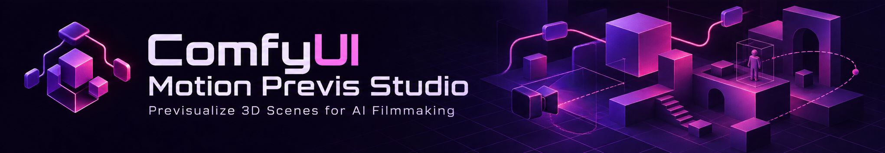
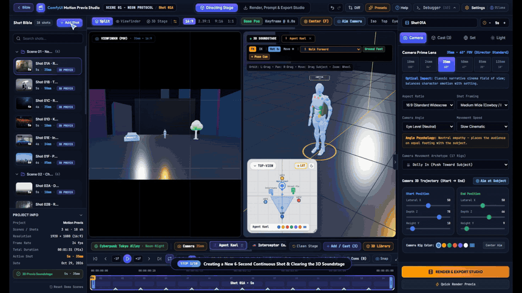
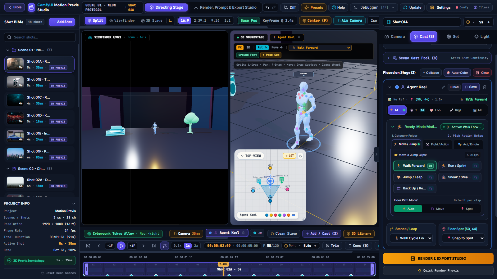
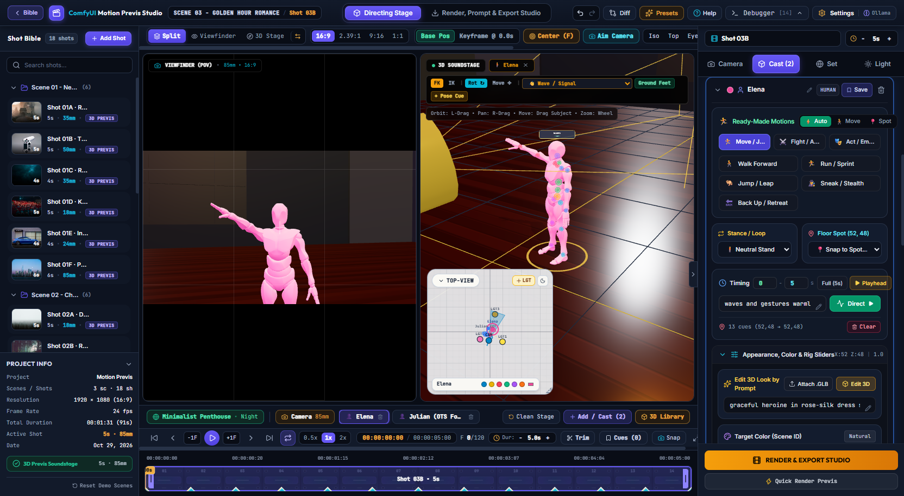
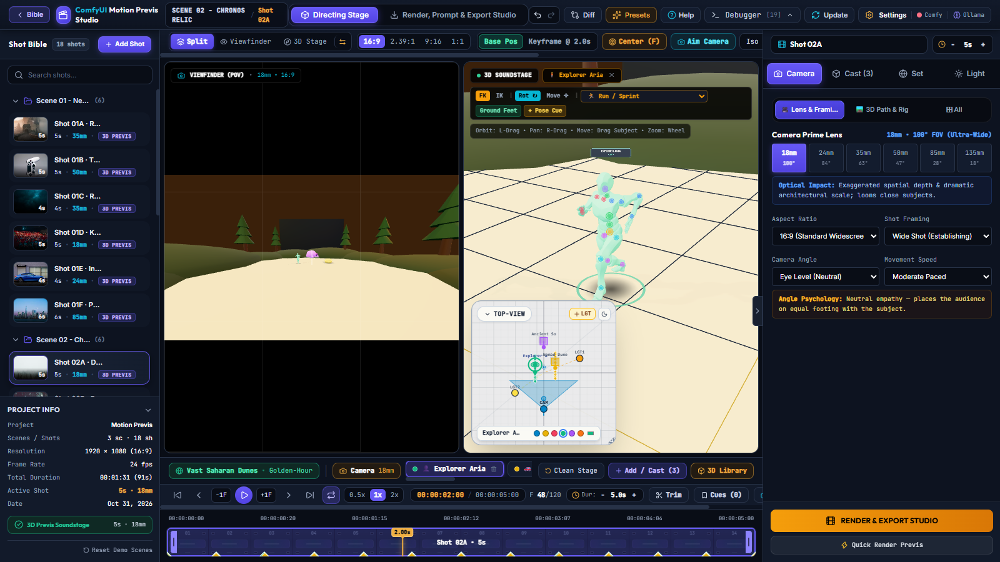
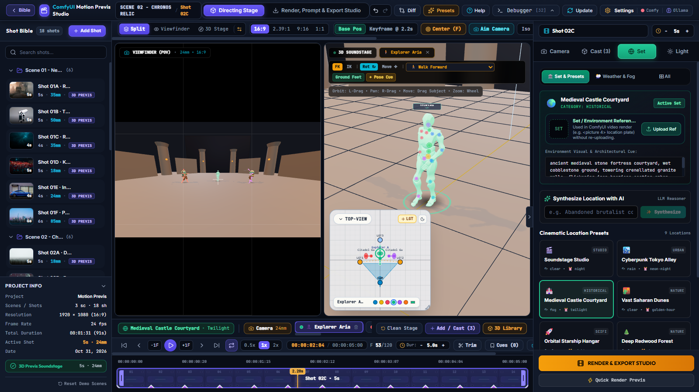

<p align="center">
  
</p>

# ComfyUI Motion Previs Studio — Cinematic Command Center 2026

> **"Direct the Shot, Not the Prompt."**  
> Built as a replacement for **Higgsfield 3D-Jutsu** — an open-source, local-first 3D camera, character, and lighting previsualization studio for AI video workflows.  
> Includes built-in interactive demo scenes for learning and instant experimentation.

**ComfyUI Motion Previs Studio** is a real-time **3D Motion Previsualization & Camera Blocking Studio** designed for filmmakers, VFX supervisors, and AI video directors. Instead of guessing text prompts for camera movement, character blocking, and lens framing, you direct actors, cameras, sets, and lights inside an interactive 3D soundstage — and export deterministic **24fps MP4 previs**, **OpenPose skeletal passes**, **Depth maps**, **4×4 camera matrices**, and **ComfyUI workflow bundles** for **LTX-2.5 (22B Distilled INT8)**, **MiniMax H3**, **Seedance**, and **any video model that accepts video reference**.

- 🧠 **Local Reasoning & Vision Models + Cloud AI**: Work **100% locally** with **Ollama** / **LM Studio** reasoning & vision models (e.g., `Qwen2.5-VL`, `LLaVA`, `Llama-3.2-Vision`, `DeepSeek-R1`, `Qwen-2.5-Coder`) — or connect **Google Gemini** and **OpenAI** directly from the in-app Settings panel for AI 3D sculpting, image-to-3D vision analysis, natural-language character acting, and directorial prompt polishing.

---

## 🎬 Live Studio Demo Video

[](https://github.com/navarisun1982/comfyui-motion-previs-studio/raw/master/docs/demo/Comfy-AI-Director-Demo.mp4)

> ▶️ **[Click here or click the preview above to watch / download the full 1080p HD Demo Video (`Comfy-AI-Director-Demo.mp4`)](https://github.com/navarisun1982/comfyui-motion-previs-studio/raw/master/docs/demo/Comfy-AI-Director-Demo.mp4)** *(also available inside the repo at [`docs/demo/Comfy-AI-Director-Demo.mp4`](docs/demo/Comfy-AI-Director-Demo.mp4))*.

---

## 📸 Visual Feature Tour & Screenshots

### 1. Full Studio Workspace — Dual 3D Viewports & 24fps Timeline

- **Left Sidebar (`Shot Bible`)**: Multi-scene, multi-shot storyboard manager with instant scene switching, shot duplication, continuity propagation, and built-in demo scenes for learning.
- **Center Dual-Viewport Stage (`3D Soundstage` + `Camera Viewfinder`)**:
  - **Left Viewport (`3D Soundstage`)**: Free-orbit director's perspective showing the 3D set, volumetric lighting cones, camera frustum rig, motion paths, and actor transform gizmos.
  - **Right Viewport (`Camera Viewfinder`)**: Live through-the-lens render locked to your chosen aspect ratio (`16:9`, `2.39:1`, `9:16`, `1:1`), focal length (`14mm`–`135mm`), and depth-of-field aperture (`f/1.4`–`f/22`).
- **Bottom Transport & Keyframe Scrubber**: Frame-accurate `24fps` timeline with camera and subject keyframe diamonds, playback loop controls, and timecode readout.

### 2. 3D Character Control Panel & Biomechanical Human Gait Engine

- **Biomechanical Human Locomotion (`gaitEngine.ts`)**: Anatomically grounded walking and running with asymmetric stance/swing timing (`60/40` walk, `38/62` run), **heel-strike → flat-foot → toe-off** ankle roll (`createFootRollController`), natural bent-elbow arm swing (`24°–38°` walk, `~90°` athletic pump in run), contrapposto pelvic sway/roll, `Spine`+`Chest` counter-torsion, `solveLookAt` horizon head stabilization, and smooth acceleration/deceleration stride envelopes.
- **Ready-Made Motion Studio**: One-click procedural biomechanical animations across **Move / Jump** (`Walk Forward`, `Run / Sprint`, `Jump / Leap`, `Sneak / Stealth`, `Back Up / Retreat`), **Fight / Action** (`Sword Slash`, `Dodge / Roll`, `Martial Combo`, `Aim & Fire`), and **Act / Emote** (`Wave / Greet`, `Heroic Taunt`, `Look Around`, `Victory Cheer`, `Talk / Dialogue`).
- **Auto / Move / Spot Execution Modes & Action Cycles (`1x`–`5x`)**: Automatically calculate floor travel paths or lock actions in-place, define exact **Action Cycles (`1x`–`5x`)** across the shot duration so gestures play naturally without robotic looping, and dial in **Facing Direction (`Body Yaw`)** (`Face Cam`, `3/4 Left`, `Profile`, `OTS Back`).
- **Natural-Language Acting Director**: Type stage directions (e.g., `"walks slowly from 30 to 48 then waves"`) to synthesize multi-cue keyframe trajectories and skeletal poses using local or cloud reasoning models.
- **ComfyUI Reference Image Sync (`<picture 1>`–`<picture 3>`) & Vision-to-3D Rigging**:
  - Upload a **ComfyUI Reference Image** directly on any character, vehicle, or prop in Directing Mode (with instant thumbnail preview and automatic upload to `D:\ComfyUI\input\`) — automatically synced to the Render & Export Studio with zero re-uploading.
  - Edit 3D look by text prompt, generate 3D props from reference images using **Vision models**, or attach custom `.GLB` 3D assets.
  - Interactive **FK/IK Bone Manipulation** right in the 3D viewport (`Pose Bones` mode) + **Socket to Character Bone** (attach props like swords, lanterns, or relics directly to `Right Hand`, `Left Hand`, `Head`, or `Spine`).

### 3. Camera & Lens Optics Deck — Close-Ups, OTS & Dynamic Trajectories

- **True Cinema Lenses**: `14mm` Ultra-Wide through `85mm` Portrait and `135mm` Telephoto Close-Up with adaptive eye-level target framing (`Close-Up`, `Extreme Close-Up`, `Medium Close-Up`, `Medium`, `Wide`).
- **Dynamic Camera Trajectories**: `Static`, `Dolly In`, `Pull Back`, `Track Left/Right`, `Orbit 360`, `Crane Up`, `Pedestal Down`, `Handheld`, and `Whip Pan` with customizable start/end path coordinates and easing curves.

### 4. 3D Set & Environment Builder + Multi-Light Studio Rig

- **Procedural 3D Environments**: Instant architectural soundstages (`Cyberpunk Alleyway`, `Ancient Temple Ruins`, `Warm Candlelit Rooftop Terrace`, `Sci-Fi Corridor`, `Film Studio Cyc Wall`) with grounded hero props, atmospheric fog, custom prompt-driven 3D object sculpting, and **Set / Background Reference Image (`<picture 4>`)** upload for ComfyUI video generation.
- **Three-Point + Practical Studio Lighting**: Interactive 3D light gizmos (`Key`, `Fill`, `Rim`, `Practical`) with real-time intensity, color temperature, cone angle, and shadow control.

### 5. Previs Render & Multi-Pass Export Deck

- **Offline Hardware-Accelerated 24fps Renderer**: Exports frame-accurate `.mp4` (via `mp4-muxer`) for **Composite Previs**, **Clean Beauty**, **OpenPose 18-Joint Skeletons**, **Normalized Depth Maps**, and **Subject Alpha Masks**.
- **Deterministic ComfyUI & Video Reference Bundles**: Exports `.zip` or JSON bundles containing your rendered control passes, `4×4` camera extrinsic matrices, compiled engine prompts, and verified ComfyUI API graphs for **LTX-2.5**, **MiniMax H3**, **Seedance**, and **any video model that accepts video reference**.

### 6. ⚡ Direct ComfyUI Live API Bridge & In-App Video Rendering (`minimax_h3_ref2va`)
- **One-Click `Render in ComfyUI (MiniMax H3)`**: Directly executes the 15-node **MiniMax H3 Ref2VA (`SolAttn` + `8-Step Turbo LoRA @ 0.7`)** workflow on your local ComfyUI server (`http://127.0.0.1:8188`) without manually exporting or importing files.
- **Automatic Previs MP4 + 4 Reference Image Binding**:
  - Renders and uploads your 24fps 3D RGB Previs MP4 directly into **Node `638` (`<Video 1>`)** as the motion & camera reference plate.
  - Synchronizes up to **4 Object, Character & Set Reference Images (`<picture 1>`–`<picture 4>`, Nodes `137` / `139` / `144` / `151`)** uploaded in Directing Mode or Render Mode with live thumbnails and interactive target object dropdowns.
  - Compiles spatially locked Ref2VA prompts (**Node `646`**) that map 3D viewport positions (`screen-left midground`, `center-frame background`, `screen-right midground`) and distinguish human character identity (`fully_preserved`) from prop/vehicle styling (`attribute_transfer`).
- **In-App `Final Render` & `Side-by-Side Sync` Player**:
  - Streams live node-by-node execution progress over WebSocket (with automatic HTTP `/history` fallback) and loads the finished **60fps MP4+Audio (`Node 145`)** directly inside the studio viewport.
  - Compare your **3D Previs MP4** side-by-side in frame-accurate sync with the **Final ComfyUI Render**, download the final `.mp4` in one click, or inspect the exact disk path (`D:\ComfyUI\output\...`).
- **Zero-CORS Local Proxy & Live GPU Status**: Built-in loopback proxy (`127.0.0.1:51731` in Electron + `/api/comfy` in Vite) and live ComfyUI connection card in **`⚙ Settings`** + top navbar `● Comfy` status indicator showing your active GPU and VRAM.

---

## 🛠️ Installation & Setup Guide

### Prerequisites
- **OS**: Windows 10 / 11, macOS, or Linux
- **Node.js**: `v20.x` or `v22.x` LTS (includes `npm`)
- **Git**: For cloning and version control
- *(Optional)* **ComfyUI** running locally at `http://127.0.0.1:8188` for live video generation (the 3D Previs Studio and MP4/ControlNet Pass Exporters run 100% locally in WebGL without requiring ComfyUI to be online).

### 1. Clone the Repository
```bash
git clone https://github.com/navarisun1982/comfyui-motion-previs-studio.git
cd comfyui-motion-previs-studio
```

### 2. Install Dependencies
```bash
npm install
```

### 3. Run in Development Mode (Browser)
```bash
npm run dev
```
Open **`http://localhost:5173`** in Chrome or Edge.

### 4. Run as a Native Desktop App (Electron)
```bash
npm run desktop
```
Or if you already ran `npm run build`:
```bash
npm run start:desktop
```

### 5. Configure AI Reasoning & Vision Models (Local Ollama, Google Gemini, OpenAI)
Click the **Settings (`⚙ Settings • Ollama / Gemini / OpenAI`)** button in the top-right header bar to switch between local and cloud AI providers at any time:

| Provider Mode | Supported Models | Capabilities Unlocked |
| :--- | :--- | :--- |
| **Local Reasoning & Vision (`Ollama` / Local Endpoint)** | `qwen2.5-vl`, `llava`, `llama3.2-vision`, `deepseek-r1`, `qwen2.5`, `llama3.3` (`http://localhost:11434`) | **100% local & private** text-to-3D procedural sculpting, **Vision image-to-3D** reference parsing, natural-language character choreography, set synthesis, and prompt polishing. |
| **Google Gemini** | `gemini-2.5-pro`, `gemini-2.5-flash`, `gemini-2.0-flash` | High-speed multimodal vision-to-3D object decomposition, complex spatial stage blocking, and engine-specific prompt directing. |
| **OpenAI** | `gpt-4o`, `gpt-4o-mini`, `gpt-4.1`, `o3-mini` | Multimodal vision reference analysis, structured 3D part-graph reasoning, and cinematic prompt compilation. |

- All motion presets, Action Cycles (`1x`–`5x`), 3D character rigging, camera optics, lighting, and offline MP4/OpenPose/Depth rendering also work **out of the box with zero API keys required**.

### 6. Connect Local ComfyUI Server & Stubelius Ultimate H3 (`stuubszzz`) Workflow Setup

If you want to render final AI videos directly inside the studio using **`⚡ Render in ComfyUI (MiniMax H3)`**, follow these steps to set up the **Stubelius Ultimate H3 (`stuubszzz`)** workflow and models in your local ComfyUI installation:

#### Step A — Download the ComfyUI Workflow & Custom Node
- 🔗 **Official Custom Node & Workflow Repository**: **[`stuubszzz/Stubelius-Ultimate-H3`](https://github.com/stuubszzz/Stubelius-Ultimate-H3)**
- 📥 **[Download Stubelius Ultimate H3 Workflow (`Stubelius_Ultimate_H3.json`)](workflows/templates/Stubelius_Ultimate_H3.json)** *(or click **`⬇ Download Stubelius H3 Workflow (.json)`** inside the studio's Render tab)*.
- 📥 **[View Bound API Workflow (`minimax_h3_ref2va.api.json`)](workflows/templates/minimax_h3_ref2va.api.json)** *(automatically executed by the studio when you click `Render in ComfyUI`)*.

#### Step B — Install Required Custom Nodes in ComfyUI
1. Install **[`stuubszzz/Stubelius-Ultimate-H3`](https://github.com/stuubszzz/Stubelius-Ultimate-H3)** via **ComfyUI Manager** (or `git clone https://github.com/stuubszzz/Stubelius-Ultimate-H3` inside `ComfyUI/custom_nodes/`).
2. Open your local ComfyUI in the browser at `http://127.0.0.1:8188`, **drag-and-drop [`Stubelius_Ultimate_H3.json`](workflows/templates/Stubelius_Ultimate_H3.json)** onto the canvas, and use **ComfyUI Manager → Install Missing Custom Nodes** if prompted (`ComfyUI-VideoHelperSuite`, `rgthree-comfy`, `ComfyUI-KJNodes`, `ComfyUI-Easy-Use`, `ComfyUI-SolAttn`).

#### Step C — Download Required MiniMax H3 Model Weights
Download the official MiniMax H3 weights from **[🤗 Comfy-Org/MiniMax-H3 on Hugging Face](https://huggingface.co/Comfy-Org/MiniMax-H3)** and place them into your `ComfyUI/models/` folder structure:

| Model Role | File Name & Download Link | Target Folder inside `ComfyUI/models/` |
| :--- | :--- | :--- |
| **Ref2VA Diffusion Model (INT8)** | [`minimax_h3_ref2va_pruned_int8_convrot.safetensors`](https://huggingface.co/Comfy-Org/MiniMax-H3/resolve/main/diffusion_models/minimax_h3_ref2va_pruned_int8_convrot.safetensors) | `ComfyUI/models/diffusion_models/` |
| **FL2VA Diffusion Model (INT8)** | [`minimax_h3_fl2va_pruned_int8_convrot.safetensors`](https://huggingface.co/Comfy-Org/MiniMax-H3/blob/main/diffusion_models/minimax_h3_fl2va_pruned_int8_convrot.safetensors) | `ComfyUI/models/diffusion_models/` |
| **Text Encoder (Qwen3-VL 32B)** | [`qwen3vl_32b_minimax_h3_int8_convrot.safetensors`](https://huggingface.co/Comfy-Org/MiniMax-H3/tree/main/text_encoders) | `ComfyUI/models/text_encoders/` |
| **8-Step Speedup LoRA** | `minimax_h3_fl2v_turbo_8step_v1.0_comfyui_bf16.safetensors` / `minimax_h3_turbo_v4_step600_ema.safetensors` | `ComfyUI/models/loras/` |
| **Video VAE (FP16)** | [`minimax_h3_video_vae_fp16.safetensors`](https://huggingface.co/Comfy-Org/MiniMax-H3/resolve/main/vae/minimax_h3_video_vae_fp16.safetensors) | `ComfyUI/models/vae/` |
| **Audio VAE (FP32)** | [`minimax_h3_audio_vae_fp32.safetensors`](https://huggingface.co/Comfy-Org/MiniMax-H3/resolve/main/vae/minimax_h3_audio_vae_fp32.safetensors) | `ComfyUI/models/vae/` |

#### Step D — Render Directly from the Studio
1. Ensure ComfyUI is running at `http://127.0.0.1:8188` and verify the green **`● Comfy`** pill in the studio's top header bar (or click **`⚙ Settings`** → **Test / Reconnect**).
2. In **Directing Mode**, upload a **ComfyUI Reference Image** on any character, vehicle, prop, or set.
3. Switch to **Render, Prompt & Export** and click **`⚡ Render in ComfyUI (MiniMax H3)`** — the studio automatically renders your 24fps 3D Previs MP4, uploads all reference assets, runs the workflow, and streams the final MP4+Audio result into the **Side-by-Side Sync** player.

---

## 🧪 Verification, Type-Checking & Tests

Run the automated Vitest suite and production TypeScript + Vite build:

```bash
# Run unit & component tests
npm test

# Run full TypeScript check + production bundle build
npm run build
```

---

## 🗺️ Upcoming Features & Roadmap

1. **🔌 Additional Live ComfyUI Workflow Templates (LTX-2.5 IC-LoRA, Wan 2.1, HunyuanVideo)**
   - Expand the live ComfyUI execution bridge beyond `minimax_h3_ref2va` with one-click live templates for **LTX-2.5 (22B Distilled INT8)** multi-controlnet (Depth + OpenPose + Camera Matrix) and **Wan 2.1**.
2. **☁️ Cloud Video API Direct Integration (Runware, Fal.ai, ComfyUI Cloud)**
   - Send exported 3D Previs plates and compiled director prompts directly to **Runware**, **Fal.ai**, and **ComfyUI Cloud** (for users without a high-VRAM local GPU) and receive the generated video back inside the Shot Bible.
3. **🎞️ Multi-Shot Timeline NLE & Sequence Assembly (Animatic-to-Final Editor)**
   - Stitch multiple shots from the **Shot Bible** into a continuous sequence timeline with cut points, transitions, dialogue/SFX audio tracks, and one-click full-scene export (Previs Animatic vs. Final AI Render).
4. **🕺 Video-to-3D Motion Capture (Extract Pose from Reference Video)**
   - Upload any real-world phone video or film clip to extract 3D skeletal motion (via local pose estimation) and apply it directly onto your 3D characters in the soundstage.
5. **🗣️ Lip-Sync, Facial Expressions & Audio-Driven Acting**
   - Attach dialogue audio clips to characters to drive automatic jaw/lip-sync visemes, eye-gaze targets, and emotional facial blendshapes during Close-Up and OTS dialogue shots.
6. **🧬 Multi-LoRA Weight & IP-Adapter Face ID Preset Manager**
   - Extend the existing `<picture 1>`–`<picture 4>` Reference Image Sync with per-character ComfyUI LoRA weight sliders and IP-Adapter FaceID embedding caches across scenes.
7. **📦 Custom `.FBX` / `.GLTF` Animation Library & Mixamo Drag-and-Drop**
   - Import custom `.FBX` / `.GLB` skeletal animations and retarget them onto any character in the studio alongside the built-in biomechanical gait engine and Action Cycles.

---

## 📂 Project Architecture

```text
├── docs/
│   ├── demo/                 # Full 1080p studio demo video & inline animated preview
│   ├── screenshots/          # Feature tour screenshots for GitHub README
│   └── ARCHITECTURE.md       # System architecture & data flow
├── public/
│   └── models/               # Rigged humanoid skeletal meshes (x-bot / y-bot)
├── src/
│   ├── adapters/             # Engine prompt & config adapters (LTX-2.5, MiniMax H3, Seedance)
│   ├── components/           # 2026 Cinematic Command Center UI
│   │   ├── ShotBible.tsx             # Multi-scene storyboard manager with built-in learning demo
│   │   ├── StagePrevis3D.tsx         # Dual-viewport Three.js soundstage & camera viewfinder
│   │   ├── PrevisParametersDeck.tsx  # Right-hand inspector (Actors, Camera, Set, Lights, Render)
│   │   ├── CharacterControlCard.tsx  # Modular 3D Character Control Panel
│   │   └── PrevisExportDeck.tsx      # 24fps MP4 & ControlNet pass renderer
│   ├── engine/
│   │   ├── kinematics/       # Biomechanical gait engine, ready-made motions, 2-bone IK, OpenPose
│   │   ├── procedural3D/     # CSG & declarative 3D sculpt compiler
│   │   ├── staging/          # 3D environment builder & subject mesh factory
│   │   └── offlinePrevisRenderer.ts  # Deterministic multi-pass MP4 muxer pipeline
│   ├── stores/               # Zustand stores (useShotStore, useHistoryStore, useAssetLibraryStore)
│   └── types/                # Canonical Zod-validated ShotSpec schemas
└── workflows/
    └── templates/            # Verified ComfyUI API workflow templates & bindings
```

---

## 📄 License

Released as Open Source.
