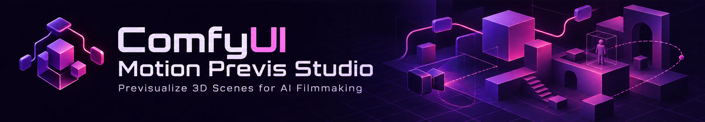
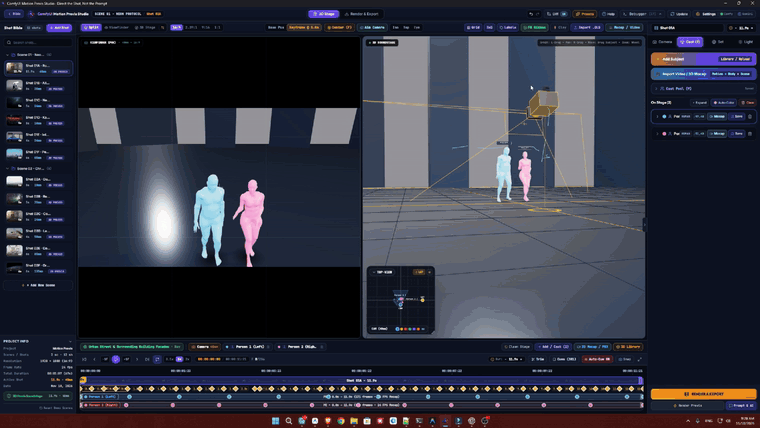
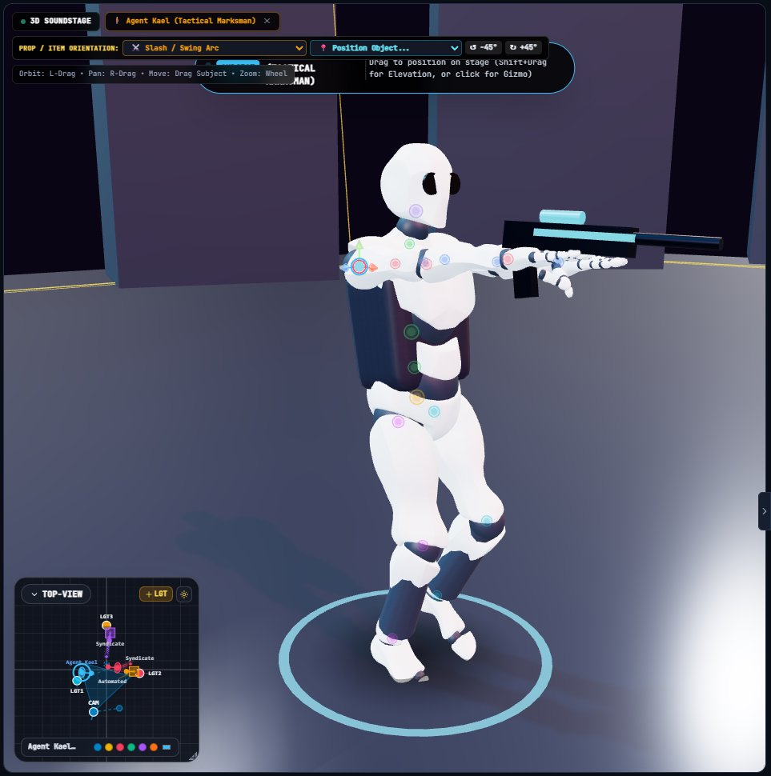
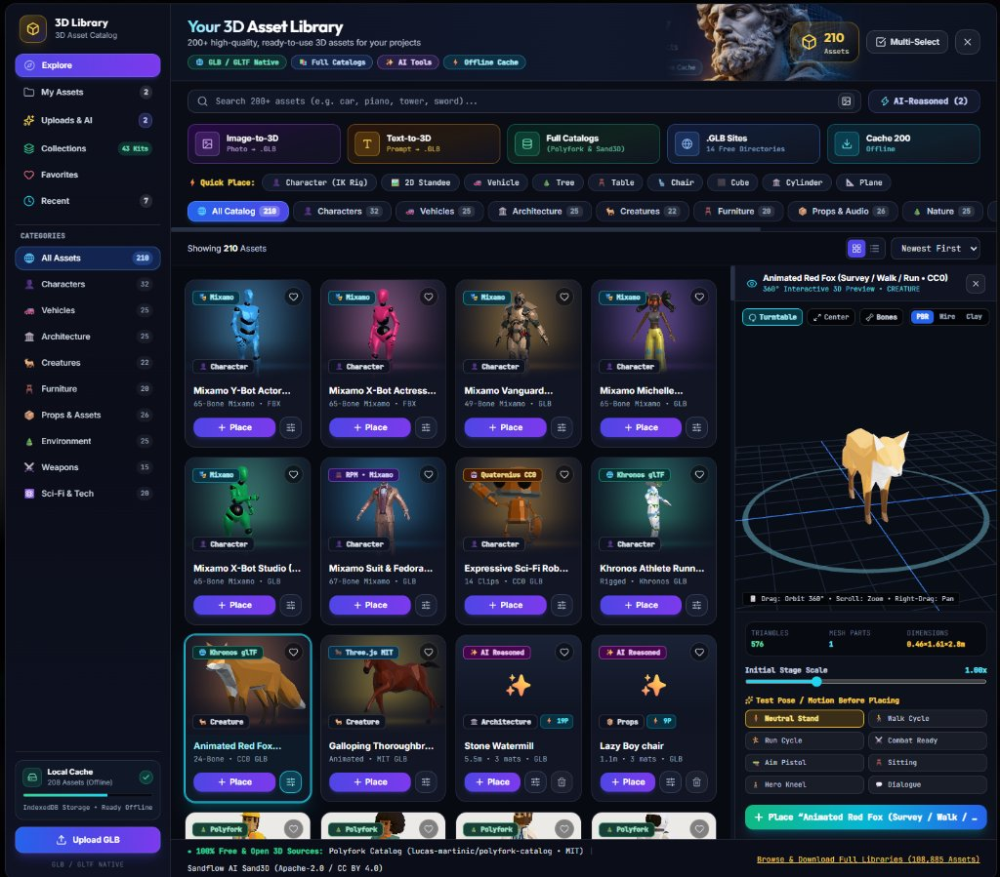
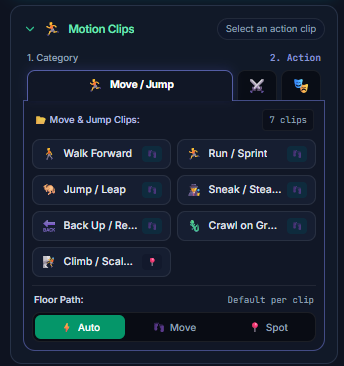
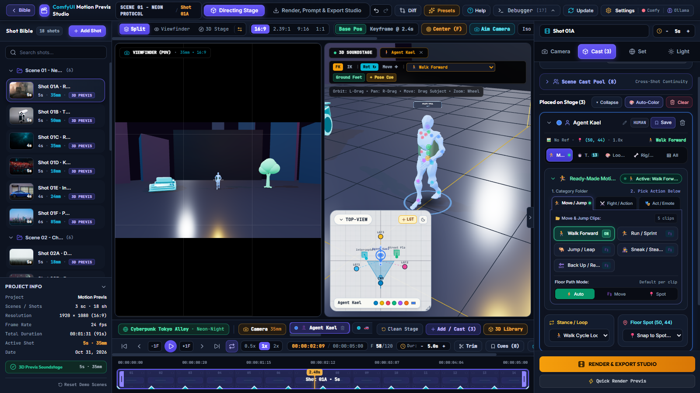
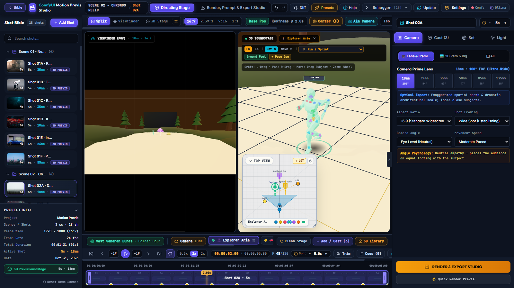
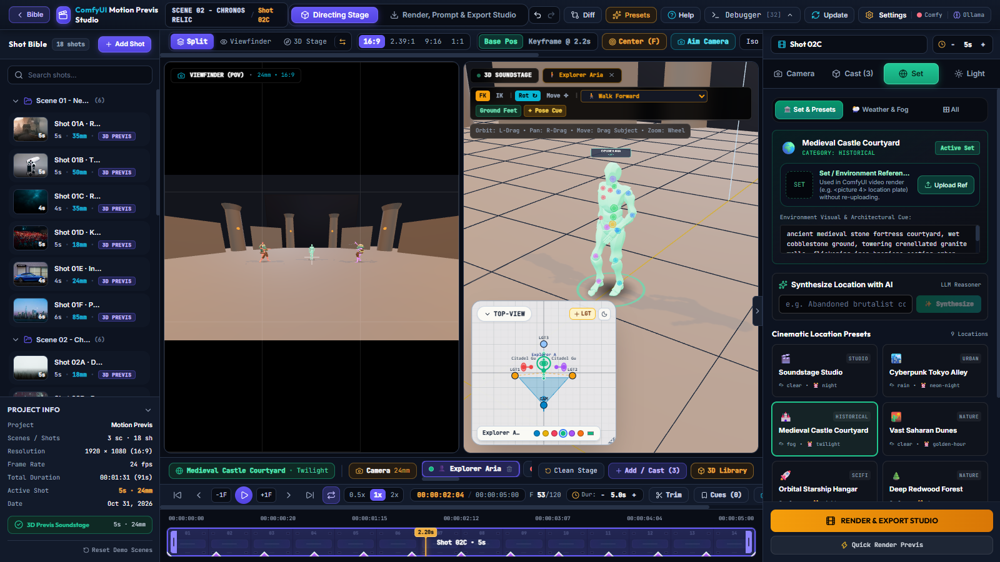
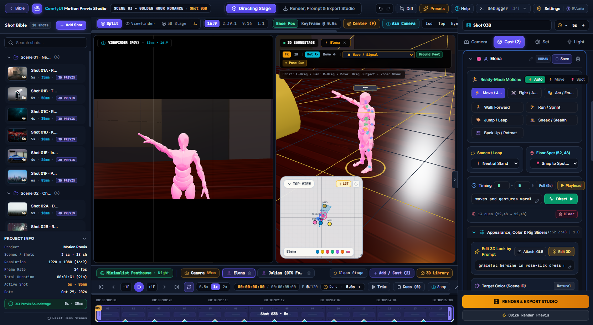

<p align="center">
  
</p>

<h1 align="center">🎬 ComfyUI Motion Previs Studio</h1>
<p align="center">
  <strong>"Direct the Shot, Not the Prompt."</strong><br/>
  <em>The Open-Source 3D Previsualization, Motion Capture & Camera Blocking Studio for AI Filmmaking in ComfyUI</em>
</p>

<p align="center">
  
  
  
  
  
  
</p>

<p align="center">
  <a href="#-why-comfyui-motion-previs-studio-stop-burning-time--credits">💡 Why This Studio?</a> •
  <a href="#-live-studio-demo-video">🎬 Demo Video</a> •
  <a href="#-13-powerhouse-features">✨ 13 Key Features</a> •
  <a href="#-7-bundled-ready-made-comfyui-workflows">📦 7 ComfyUI Workflows</a> •
  <a href="#-visual-feature-tour--screenshots">📸 Screenshots</a> •
  <a href="#️-1-click-installation--quick-start">🚀 Quick Start</a>
</p>

---

## 💡 Why ComfyUI Motion Previs Studio? (Stop Burning Time & Credits)

### The Problem with AI Video Today
Directing AI video by typing text prompts alone is like directing a movie blindfolded. Creators routinely spend **hours of waiting** and burn **hundreds of GPU hours or paid API credits** re-rolling the same prompt 30 times just to get:
- A camera to orbit smoothly around a subject instead of drifting away.
- Two characters to walk past each other without merging or teleporting.
- An actor to enter the frame at the exact 2-second mark, stop, and perform a specific action.

### How Our Studio Solves It Practically
**ComfyUI Motion Previs Studio** lets you **build, direct, and preview your entire shot in a real-time 3D stage at 60 FPS — costing $0 in credits and 0 seconds of rendering wait time.**

1. **Stage Your Scene in Seconds**: Pick from **200+ built-in 3D characters, props, and environments**, generate new 3D `.GLB` models from an image or text prompt, or extract **real 3D human motion & camera movement directly from any video**.
2. **Direct Timing & Camera Like a Filmmaker**: Apply ready-made animations (`Walk`, `Run`, `Fight`, `Sit`, `Crawl`), drag cues on a 24fps timeline, and frame your shot through real cinema lenses (`14mm` to `135mm`).
3. **Render Once with 100% Confidence**: When your 3D preview looks right, click **Render in ComfyUI**. The studio automatically exports the exact control pass (`Clay`, `RGB`, `Depth`, or `OpenPose`), binds your reference images, compiles a camera-accurate prompt, and renders the final AI video on the very first try.

> 🔧 **Tech Under the Hood:** *Built with React 19, TypeScript, Three.js WebGL2, Zustand, Zod-validated `ShotSpec` schemas, `mp4-muxer` hardware-accelerated encoding, and a direct WebSocket/REST bridge to local ComfyUI.*

---

## 🎬 Live Studio Demo Video

[](https://github.com/navarisun1982/comfyui-motion-previs-studio/raw/master/docs/demo/Comfy-AI-Director-Demo.mp4)

---

## 🧭 End-to-End Production Pipeline

```mermaid
flowchart LR
    subgraph Input["1. Build or Capture 3D Scene"]
        A1["🏛️ 200+ 3D Asset Library\n& Ready-Made Motion Clips"]
        A2["🕺 3D Video Mocap Studio\n(Real SMPL 6,890v or Mixamo Y-Bot)"]
        A3["🧊 ComfyUI Image/Text-to-3D\n(.GLB + Auto Bone Rigging)"]
    end

    subgraph Stage["2. Direct on the 3D Stage (0 Credits)"]
        B1["🎥 Dual 3D Viewports\n& Cinema Lenses (14mm–135mm)"]
        B2["🎞️ 24fps Cue Swimlanes\nSpeed Stretch & +Chain"]
        B3["🤸 Bilingual Text-to-Motion\n6-Effector IK Synthesizer"]
    end

    subgraph Export["3. Smart Multi-Pass & Prompt Engine"]
        C1["🎨 4-Channel 24fps MP4\n(Clay / RGB / Depth / OpenPose)"]
        C2["👁️ Camera-POV Frustum\nVisibility Prompt Compiler"]
        C3["🧠 Workflow Output Registry\n& Channel Auto-Advisor"]
    end

    subgraph Render["4. Final ComfyUI Generation"]
        D1["⚡ LTX-2 19B IC-LoRA Union\n& LTX-2.5 22B"]
        D2["🎬 MiniMax H3 Ref2VA\n& Stubelius Ultimate"]
        D3["🖥️ Side-by-Side Sync Player\n(3D Previs vs Final Render)"]
    end

    Input --> Stage --> Export --> Render
```



---

## ✨ 13 Powerhouse Features

### 1. 🧊 ComfyUI Image-to-3D & Text-to-3D `.GLB` Studio + Auto-Rigging
**How it helps you:** Turn any 2D concept picture or text idea into a textured, posable, animated 3D `.GLB` character or prop right inside the app—powered by your local ComfyUI server.
- **🖼️ Image-to-3D Mode**: Upload any PNG/JPG/WebP character or object image. ComfyUI removes the background, estimates 3D depth, reconstructs a textured `.GLB` mesh, and links your image as `<picture 1>` for final video rendering.
- **✍️ Text-to-3D Mode**: Type a description of any character, creature, or prop. ComfyUI first generates a clean studio concept image and immediately converts it into a 3D `.GLB` model.
- **🦴 Instant Automatic Bone Rigging (`4 Archetypes`)**: Every generated or uploaded `.GLB` is automatically rigged at 60 FPS as a **`🧍 Humanoid (19-Bone)`**, **`🐾 Quadruped (4-Leg Animal)`**, **`🐍 Flexible Spine`**, or **`📦 Rigid Prop`**, complete with an interactive **Joint Landmark Fine-Tuner** and X-ray bone preview.

> 🔧 **Tech Under the Hood:** *ComfyUI workflows `#aa77013b` & `#e7a9555b` (`Pixal3D INT8`, `TRELLIS.2 INT8`, `Hunyuan3D-2.1 PBR`, `Z-Image Turbo FP8`, `Qwen-3-4B`, `BiRefNet`, `MoGe Depth`) + silhouette-aware `SkinnedMesh` auto-rigger (`autoRigEngine.ts`).*

---

### 2. 🕺 3D Video Mocap & Camera Tracking Studio (`Real SMPL Body` vs. `Mixamo Y-Bot`)
**How it helps you:** Have a real-life video clip with great acting or camera movement? Upload any RGB video (up to 30 seconds) and convert the people, camera motion, and surrounding buildings into an editable 3D scene on your stage.
- **Multi-Person 3D Motion Capture (`1..N` Actors)**: Automatically detects and tracks multiple people moving in 3D depth space—even when they cross paths.
- **User Choice of 3D Character Mesh**:
  - **🧬 Real SMPL Body (`6,890 Vertices`)**: Reconstructs realistic 3D human body meshes shaped to match each person's real-world height, shoulder breadth, chest/waist/hip proportions, and body build (`slim`, `average`, `athletic`, `stocky`, `heavy`) from the video.
  - **🤖 Mixamo Y-Bot (`1:1 Natural`)**: Retargets the extracted 3D motion onto the classic Mixamo Y-Bot mannequin while keeping its clean, natural 1:1 proportions with zero stretching or distortion.
- **3D Camera Tracking & Scene Reconstruction**: Extracts the video's camera focal length (`mm`) and 6-DoF movement (`pan`, `tilt`, `dolly`, `truck`) plus nearby 3D architectural blocks.

> 🔧 **Tech Under the Hood:** *Local GPU `NLF-Large` (`nlf_l_multi_0.3.2.torchscript`) 3D SMPL-24 extractor (`scripts/mocap_nlf_extractor.py`), auto-generated 6,890-vertex / 13,776-face PCA shape blendshape skinning engine (`smplMannequinLoader.ts`), MediaPipe 33-landmark 3D fallback, and 6-DoF Camera Odometry.*

---

### 3. 🦴 Interactive Bone Posing (`FK/IK`) & Prop-to-Hand Socketing



**How it helps you:** Dial in custom poses by hand or put a sword, lantern, or camera prop directly into a character's hand so they carry it naturally while walking or fighting.
- **Direct 3D Bone Manipulation (`Pose Bones`)**: Click any joint on a character (`Shoulder`, `Elbow`, `Wrist`, `Hip`, `Knee`, `Head`, `Spine`) and rotate it directly in the 3D viewport.
- **1-Click Bone Socketing**: Attach any 3D prop in your scene to a character's `Right Hand`, `Left Hand`, `Head`, or `Chest/Spine`—the prop automatically follows the character's hand or body through every animation frame.

> 🔧 **Tech Under the Hood:** *Interactive Three.js `TransformControls` joint rotation overrides and real-time skeletal world-matrix bone socket parenting.*

---

### 4. 🏛️ 200+ Built-In 3D Asset Library & Custom `.GLB` Collection



**How it helps you:** You never have to start from an empty screen or hunt for 3D models online. Open the library and populate a complete movie scene in seconds.
- **200+ Curated 3D Models**: Browse ready-to-use characters, articulated mannequins, cars, motorcycles, creatures, trees, buildings, furniture, weapons, and stage props organized by category.
- **Personal `⭐ My Uploads & AI` Vault**: Import your own `.GLB` or `.FBX` files from disk or save models generated by ComfyUI—automatically stored in your browser and synced with your local `ComfyUI/output/3d/` folder.
- **1-Click Stage Spawn**: Drop any character or prop onto the 3D floor, swap models at any time, and attach a `<picture>` reference photo for AI video styling.

> 🔧 **Tech Under the Hood:** *Three.js `GLTFLoader` & `FBXLoader`, persistent IndexedDB `modelStorage` vault, and automatic local filesystem discovery (`D:\ComfyUI\output\3d\`).*

---

### 5. 🏃 20+ Ready-Made Motion Clips & Realistic Human Gait Engine



**How it helps you:** Animate characters like a pro with zero 3D animation experience. Pick a movement from a visual menu and watch your character perform it immediately with realistic human weight and balance.
- **3 Organized Motion Categories**:
  - **Move / Jump**: `Walk Forward`, `Run / Sprint`, `Jump / Leap`, `Sneak / Stealth`, `Back Up / Retreat`, `Crawl (Prone)`, `Climb / Scale`.
  - **Fight / Action**: `Sword Slash`, `Dodge / Roll`, `Martial Combo`, `Aim & Fire`, `Push / Shove`, `Fall / Collapse`.
  - **Act / Emote**: `Wave / Greet`, `Talk / Dialogue`, `Sit Down`, `Stand Up / Rise`, `Kneel / Bow`, `Heroic Taunt`, `Victory Cheer`, `Look Around`.
- **Smart Floor Travel vs. In-Place (`Auto / Move / Spot`)**: Let walking/running characters automatically travel along their floor path, or lock them in one spot.
- **Action Cycles (`1x`–`5x`) & Body Facing**: Choose exactly how many times a gesture repeats across the shot so movements never loop robotically, and set facing angles (`Face Cam`, `3/4 Left`, `Profile`, `OTS Back`).

> 🔧 **Tech Under the Hood:** *Biomechanical Gait Engine (`gaitEngine.ts`) featuring asymmetric stance/swing timing (`60/40` walk, `38/62` run), heel-strike to toe-off foot roll (`createFootRollController`), contrapposto pelvic sway, spine counter-torsion, and `solveLookAt` horizon head stabilization.*

---

### 6. 🤸 Bilingual Text-to-Motion AI Director (English & Arabic)
**How it helps you:** Need a custom action that isn't in the preset buttons? Type any movement in plain **English or Arabic**—including multi-step instructions—and watch the character act it out on the 3D stage.
- **Natural Multi-Step Choreography**: Type phrases like *"crawl on the ground then stand up"*, *"walk right then sit down"*, or *"رجل يزحف على الأرض ثم يقوم"* and click **Direct**.
- **Full-Body Coordination**: The engine coordinates all 6 body zones (hips, spine, both hands, both feet, and head gaze) simultaneously so characters bend, reach, kneel, or climb naturally.
- **Works Offline or with Local/Cloud LLMs**: Runs instantly out-of-the-box using our built-in kinematic parser, and can optionally connect to local **Ollama** (`deepseek-r1`, `qwen2.5`, `llama3.3`), **Google Gemini**, or **OpenAI** for open-ended choreography.

> 🔧 **Tech Under the Hood:** *Analytical 2-Bone Inverse Kinematics solver (`ikSolver.ts`) + Universal 6-Effector IK Motion Synthesizer (`universalMotionSynthesizer.ts`) + bilingual LLM kinematic program generator (`aiActingDirector.ts`).*

---

### 7. 🎞️ 24fps Multi-Track Cue Timeline, Speed Stretching & `+ Chain` Directing
**How it helps you:** Control *when* every action happens and *how fast* it plays using simple drag-and-drop bars—just like editing clips in a video editor.
- **Color-Coded Character & Camera Swimlanes**: Every actor on stage gets their own timeline track with distinct icons for movement (`◆`), acting (`●`), and jumping (`▱`), alongside a dedicated `[CAM]` camera track.
- **Drag-and-Drop Retiming & Speed Stretch Handles**: Drag a cue left or right to change its start time, or grab the edges of a cue bar to stretch/compress the action speed.
- **1-Click Pacing Curves**: Change the energy of any movement with `Linear`, `Smooth`, `Burst ⚡` (explosive start), or `Ramp ↗` (gradual build-up).
- **`+ Chain` Sequential Actions**: Click **`+ Chain`** to add a second or third action right where the previous one finished (e.g., *walk to center → kneel down → look around*) without resetting the character.

> 🔧 **Tech Under the Hood:** *Deterministic 24fps multi-subject keyframe evaluator (`trajectoryMath.ts`), non-linear time-warping easing curves, and stateful pose/position handoff chaining.*

---

### 8. 🎥 Dual 3D Viewports, Cinema Lenses & Live Top-View Radar
**How it helps you:** See both the "behind-the-scenes" set and the exact camera shot at the same time, so you never have to guess how lens focal length or camera angles will look.
- **Left Viewport (`3D Soundstage`)**: Free-orbit director's view showing the whole room, lighting cones, camera rig, and floor paths.
- **Right Viewport (`Camera Viewfinder`)**: Locked to your exact output aspect ratio (`16:9`, `2.39:1 Anamorphic`, `9:16 Vertical`, `1:1`), lens focal length (`14mm` Ultra-Wide to `135mm` Telephoto Close-Up), aperture (`f/1.4`–`f/22`), and Dutch roll (`-45°` to `+45°`).
- **Dynamic Camera Moves & 2D Top-View Radar**: Choose `Static`, `Dolly In`, `Pull Back`, `Track L/R`, `Orbit CW/CCW`, `Spiral Orbit`, `Crane Arc`, `FPV Dive`, `Steadicam Follow`, or `Whip Pan` and preview the curved path live on the 2D radar map.

> 🔧 **Tech Under the Hood:** *Synchronized dual-pass Three.js WebGL2 rendering, real sensor/focal-length FoV math, and `evaluateLiveCameraStageState` orbital/pan trajectory evaluation.*

---

### 9. 🌆 1-Click 3D Environments & Three-Point Studio Lighting
**How it helps you:** Place your characters inside a rich 3D architectural set and light them cinematically in seconds without building environments from scratch.
- **Ready-Made 3D Soundstages**: Switch instantly between `Cyberpunk Alleyway`, `Ancient Temple Ruins`, `Warm Candlelit Rooftop Terrace`, `Sci-Fi Corridor`, and `Film Studio Cyc Wall`, or upload a `<picture 4>` background reference image.
- **Interactive 3D Lighting Rig**: Position and aim `Key`, `Fill`, `Rim`, and `Practical` 3D light gizmos with live controls for brightness, color warmth, cone angle, atmospheric fog, and real-time shadows.

> 🔧 **Tech Under the Hood:** *Procedural PBR environment generator (`environmentBuilder.ts`), shadow-mapped `SpotLight` / `DirectionalLight` rigs, and volumetric fog shaders.*

---

### 10. 🎨 4-Channel Previs Renderer (`Clay`, `RGB`, `Depth`, `OpenPose`) & Smart Workflow Advisor
**How it helps you:** Different ComfyUI video workflows work best with different types of guide videos. The studio renders all 4 industry-standard control passes and automatically picks the right one for your chosen workflow.
- **4 Real-Time & Offline 24fps Render Channels**:
  - **🗿 Clay (Neutral Grey Previs)**: Renders characters and buildings in clean studio clay so **LTX-2 IC-LoRA** captures pure 3D motion and lighting while taking 100% of its colors from your prompt and `<picture 1>` reference (with zero grey color bleed).
  - **🎨 RGB (Color-Coded Motion)**: Distinct limb and subject color encoding for motion-transfer workflows.
  - **🌫️ Depth (Normalized Z-Buffer)**: Smooth near-to-far depth maps for 3D structure conditioning.
  - **🦴 OpenPose (18-Joint Skeleton)**: High-contrast skeletal pose pass on pure black for ControlNet Pose.
- **Smart Workflow Advisor & Auto-Switch**: Automatically knows the output node (`SaveVideo`, `VHS_VideoCombine`, `SaveGLB`, `Hy3DExportMesh`) and ideal render channel for every bundled or custom workflow, offering 1-click **`Switch to Recommended`** and automatic channel switching.

> 🔧 **Tech Under the Hood:** *Hardware-accelerated `mp4-muxer` offline renderer (`offlinePrevisRenderer.ts`), deterministic `workflowOutputRegistry.ts` graph inspector, and adaptive `LTXVAddGuide` IC-LoRA control strength calibration (`0.65` in Clay mode).*

---

### 11. 👁️ Camera-POV Smart Prompt Compiler
**How it helps you:** Most prompt tools describe everything on the stage—even objects hidden behind the camera, which confuses AI video models. Our studio checks the actual Camera Viewfinder and only describes what the camera truly sees.
- **Exact Entry & Exit Timestamps**: Automatically detects when each character or prop enters or leaves the camera frame (e.g., *"Lead Actor enters frame at 1.2s and exits at 2.8s"*) and leaves off-screen objects out of the prompt completely.
- **Tailored for Each Video Model**: Formats prompts specifically for **LTX-2 / LTX-2.5** (flowing cinematic T5 paragraph), **MiniMax H3 Ref2VA** (`<Video 1>` + `<picture 1>`–`<picture 4>` subject definitions), and **Seedance 2.0** (`@Video1` + `@Image1` multimodal tags).

> 🔧 **Tech Under the Hood:** *25-sample 3D `PerspectiveCamera` frustum bounding-sphere visibility engine (`povVisibilityEngine.ts`) and multi-engine adapter compilers (`ltxAdapter.ts`, `minimaxAdapter.ts`, `seedanceAdapter.ts`).*

---

### 12. ⚡ Live ComfyUI Rendering & Side-by-Side Sync Comparison Player
**How it helps you:** Send your 3D preview and reference photos straight to ComfyUI with a single button click, watch live progress, and compare your 3D blocking against the final AI video side-by-side.
- **Zero Manual File Shuffling**: Automatically uploads your rendered 24fps Previs MP4 and up to **4 Reference Images (`<picture 1>`–`<picture 4>`)** directly into the right ComfyUI nodes.
- **In-App `Side-by-Side Sync` Player**: Play your **3D Previs MP4** and the **Final ComfyUI Render** locked together frame-by-frame to verify motion accuracy, or compare shot revisions in **Director Diff**.

> 🔧 **Tech Under the Hood:** *Schema-verified ComfyUI API graph binder (`templateLoader.ts`), live WebSocket + HTTP `/history` execution tracker, and zero-CORS loopback proxy (`127.0.0.1:51731`).*

---

### 13. 📖 Multi-Scene Shot Bible, Interactive Demos & Dedicated Local Studio Storage
**How it helps you:** Plan a single shot or a full multi-scene short film, learn the studio in minutes with pre-built interactive scenes, and keep all your generated files organized on your own hard drive.
- **Shot Bible & Built-In Learning Scenes**: Switch between scenes and shots, duplicate setups, maintain character continuity across cuts, or load built-in demo scenes with one click.
- **Dedicated `studio_storage/` Disk Folder**: Every generated `.GLB` asset, ComfyUI video render, Previs MP4 export, and custom workflow is neatly saved to your local disk (`studio_storage/` or any custom folder you choose in `⚙ Settings`).

> 🔧 **Tech Under the Hood:** *Zustand stores (`useShotStore`, `useHistoryStore`, `useComfyStore`, `useAssetLibraryStore`) with undo/redo history and local disk storage middleware.*

---

## 📦 7 Bundled Ready-Made ComfyUI Workflows

All **7 production-tested ComfyUI workflows** powering this studio are included inside [`workflows/templates/`](workflows/templates/). Click **`📥 Workflows Pack`** inside the app header to download any workflow (both drag-and-drop **ComfyUI UI `.json`** and **API `.api.json`**) or **Download All Workflows** in one click:

| # | Workflow Name | Category | Recommended Previs Channel | ComfyUI UI Workflow (Drag & Drop) | API Execution Graph | Core Models Used |
| :--- | :--- | :--- | :--- | :--- | :--- | :--- |
| **1** | **⚡ LTX-2 19B IC-LoRA Union Control (`v4.2`)** | Video VFX | `🗿 Clay` *(Auto-tuned `0.65`)* | [`ComfyUI_LTX2_ICLoRA_Union_Control_Workflow.json`](workflows/templates/ComfyUI_LTX2_ICLoRA_Union_Control_Workflow.json) | [`ltx2_iclora_union_control.api.json`](workflows/templates/ltx2_iclora_union_control.api.json) | LTX-2 19B Distilled FP8, Union IC-LoRA, Gemma-3 12B, LTXV Audio VAE |
| **2** | **🎬 MiniMax H3 Multi-Subject Ref2VA** | Video + Audio | `🎨 RGB` | [`MiniMax_H3_Ref2VA_ComfyUI_Workflow.json`](workflows/templates/MiniMax_H3_Ref2VA_ComfyUI_Workflow.json) | [`minimax_h3_ref2va.api.json`](workflows/templates/minimax_h3_ref2va.api.json) | MiniMax H3 Ref2VA INT8, SolAttn, 8-Step Turbo LoRA, RIFE 60fps |
| **3** | **🎥 MiniMax H3 Stubelius Ultimate Director** | Video + Audio | `🎨 RGB` | [`Stubelius_Ultimate_H3.json`](workflows/templates/Stubelius_Ultimate_H3.json) | [`h3_stubelius.api.json`](workflows/templates/h3_stubelius.api.json) | MiniMax H3 Ref2VA & FL2VA, Qwen3-VL 32B, Video + Audio VAE |
| **4** | **🎞️ LTX-2.5 22B Distilled INT8 VFX** | Video VFX | `🎨 RGB` / `🌫️ Depth` | — | [`ltx25_stubelius.api.json`](workflows/templates/ltx25_stubelius.api.json) | LTX-2.5 22B Distilled INT8, T5-XXL FP8 |
| **5** | **🖼️ Image-to-3D `.GLB` Reconstruction** | 3D `.GLB` | — | [`ComfyUI_Image_to_3D_GLB_Workflow.json`](workflows/templates/ComfyUI_Image_to_3D_GLB_Workflow.json) | [`comfy_image_to_3d_glb.api.json`](workflows/templates/comfy_image_to_3d_glb.api.json) | Pixal3D INT8, TRELLIS.2 INT8, BiRefNet, MoGe v1, DINOv3 |
| **6** | **✍️ Text-to-3D `.GLB` Studio Generator** | 3D `.GLB` | — | [`ComfyUI_Text_to_3D_GLB_Workflow.json`](workflows/templates/ComfyUI_Text_to_3D_GLB_Workflow.json) | [`comfy_text_to_3d_glb.api.json`](workflows/templates/comfy_text_to_3d_glb.api.json) | Z-Image Turbo FP8, Qwen-3-4B, Flux VAE, BiRefNet, Pixal3D / TRELLIS.2 |
| **7** | **🛡️ Hunyuan3D-2.1 Normal & PBR `.GLB`** | 3D `.GLB` | — | [`ComfyUI_Hunyuan3D_21_GLB_Workflow.json`](workflows/templates/ComfyUI_Hunyuan3D_21_GLB_Workflow.json) | [`comfy_hunyuan3d_21_glb.api.json`](workflows/templates/comfy_hunyuan3d_21_glb.api.json) | Hunyuan3D-DiT-v2-1 FP16, Hy3D Paint PBR Multi-View, BiRefNet |

---

## 📸 Visual Feature Tour & Screenshots

### 1. Full Studio Workspace — Dual 3D Viewports & 24fps Cue Timeline


### 2. 3D Character Control Panel, Motion Clips & Bilingual AI Motion Director


### 3. Camera & Lens Optics Deck — Real Focal Lengths & Live Top-View Radar


### 4. 3D Soundstage Environments & Three-Point Studio Lighting


### 5. Multi-Pass Previs Render (`Clay` / `RGB` / `Depth` / `OpenPose`) & Live ComfyUI Bridge


---

## 🛠️ 1-Click Installation & Quick Start

### Prerequisites
- **OS**: Windows 10 / 11, macOS, or Linux
- **Node.js**: `v20.x` or `v22.x` LTS (includes `npm`)
- *(Optional)* **ComfyUI** running locally at `http://127.0.0.1:8188` for live 3D `.GLB` generation, NLF 3D SMPL video mocap, and live video rendering. *(The 3D Previs Stage, 200+ Asset Library, Motion Clips, and 24fps MP4/ControlNet Exporters work 100% locally in your browser/desktop app even when ComfyUI is offline!)*

### 1. Clone the Repository
```bash
git clone https://github.com/navarisun1982/comfyui-motion-previs-studio.git
cd comfyui-motion-previs-studio
```

### 2. ⚡ One-Click Launch on Windows (`start_studio.bat` / `run.bat`)
On Windows, simply **double-click [`start_studio.bat`](start_studio.bat)** (for Browser Mode) or **[`run.bat`](run.bat)** (for the Native Electron Desktop App):
- Automatically runs `npm install` on first launch if needed.
- Applies our branded 3D studio icon (`Assets/logo.ico`) and creates a desktop shortcut.
- Starts the studio server and opens **`http://127.0.0.1:5173`** (or launches the native desktop window).

### 3. Manual CLI Setup (Windows / macOS / Linux)
```bash
# Install dependencies
npm install

# Run in Browser Mode (http://localhost:5173)
npm run dev

# Or launch as a Native Desktop App (Electron)
npm run desktop
```

### 4. Optional AI Directing Providers (`⚙ Settings`)
Open **`⚙ Settings`** in the top header bar to connect optional local or cloud LLMs for natural-language choreography and prompt polishing:

| Provider Mode | Supported Models | What It Unlocks |
| :--- | :--- | :--- |
| **Local (`Ollama` / Local Endpoint)** | `deepseek-r1`, `qwen2.5`, `llama3.3` (`http://localhost:11434`) | **100% free, local & private** bilingual character choreography and prompt directing. |
| **Google Gemini** | `gemini-2.5-pro`, `gemini-2.5-flash`, `gemini-2.0-flash` | High-speed spatial stage blocking and engine-specific video prompt compilation. |
| **OpenAI** | `gpt-4o`, `gpt-4o-mini`, `gpt-4.1`, `o3-mini` | Natural-language acting direction and cinematic prompt refinement. |

---

## 🧪 Verification, Type-Checking & Automated Tests

Run the full **468-test Vitest suite** and production TypeScript + Vite build:

```bash
# Run all 56 test suites (468 unit & integration tests)
npm test

# Run full TypeScript check + production bundle build
npm run build
```

---

## 📂 Project Architecture

```text
├── docs/
│   ├── demo/                 # Full 1080p studio demo video & animated preview
│   ├── screenshots/          # Visual feature tour screenshots
│   └── ARCHITECTURE.md       # System architecture & data flow
├── public/
│   ├── images/               # Studio UI icons & hero thumbnails
│   └── models/               # Rigged 3D humanoid & creature meshes (.glb / .fbx)
├── scripts/
│   └── mocap_nlf_extractor.py# Local GPU NLF-Large 3D SMPL-24 multi-person extractor
├── src/
│   ├── adapters/             # Engine prompt & config adapters (LTX-2/2.5, MiniMax H3, Seedance)
│   ├── components/           # 2026 Cinematic Command Center UI
│   │   ├── MocapStudioModal.tsx      # 3D Video Mocap Studio (Real SMPL 6,890v vs Mixamo Y-Bot)
│   │   ├── AIGenerator3D.tsx         # ComfyUI Image-to-3D & Text-to-3D .GLB Studio + Auto-Rigger
│   │   ├── BundledWorkflowsModal.tsx # 1-Click downloader for all 7 bundled ComfyUI workflows
│   │   ├── AssetLibraryModal.tsx     # 200+ Curated 3D Assets + Custom .GLB Vault
│   │   ├── StagePrevis3D.tsx         # Dual-viewport Three.js soundstage & camera viewfinder
│   │   ├── MotionPrevisStage.tsx     # 24fps transport bar, Cue swimlanes & speed stretching
│   │   ├── CharacterControlCard.tsx  # Motion clips, Bilingual IK Director & Cue Ribbon
│   │   ├── PrevisExportDeck.tsx      # 4-Channel MP4 exporter, Workflow Advisor & ComfyUI Bridge
│   │   ├── ShotBible.tsx             # Multi-scene storyboard manager & built-in learning demos
│   │   └── DirectorDiffModal.tsx     # Side-by-side shot revision & video diff inspector
│   ├── engine/
│   │   ├── kinematics/               # SMPL 6,890v loader, Mixamo loader, Auto-Rigger, Gait & 6-Effector IK
│   │   ├── staging/                  # Procedural 3D environments & subject mesh factory
│   │   ├── vfx/                      # Video mocap analyzer, 6-DoF camera tracker & scene reconstructor
│   │   ├── workflowOutputRegistry.ts # Deterministic ComfyUI output node & channel advisor registry
│   │   ├── povVisibilityEngine.ts    # 3D Camera-POV frustum visibility & timestamp analyzer
│   │   ├── promptCompiler.ts         # Official model-specific prompt compilers
│   │   └── offlinePrevisRenderer.ts  # Hardware-accelerated 4-channel 24fps MP4 renderer
│   ├── services/             # ComfyUI REST/WS client, 3D generator, storage & LLM directors
│   ├── stores/               # Zustand stores (useShotStore, useHistoryStore, useComfyStore)
│   └── types/                # Canonical Zod-validated ShotSpec schemas
└── workflows/
    └── templates/            # 7 Bundled ComfyUI UI (.json) & API (.api.json) workflows + bindings
```

---

## 📄 License

Released under the **MIT License**.
