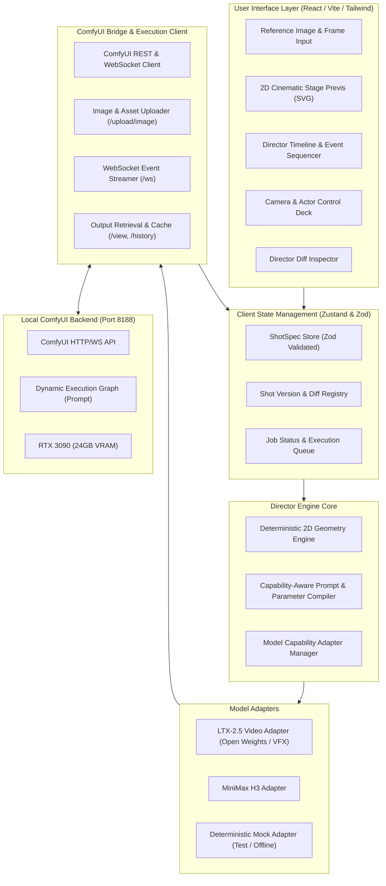

# AI Director Studio — Technical Architecture & System Design

## 1. Architectural Philosophy: Direct the Shot, Not the Prompt

Most AI video tools reduce directorial intent to arbitrary string manipulation ("cinematic drone shot, 8k, photorealistic"). **AI Director Studio** inverts this relationship:
1. **The Director controls cinematic physics**: Camera placement, focal length, trajectory vectors (pan, tilt, pedestal, dolly, truck, zoom, roll, orbit), actor blocking, movement pacing, and lighting contrast.
2. **The Studio compiles cinematic intent**: The structured `ShotSpec` is translated deterministically into model-specific guidance — combining precise workflow conditioning (e.g. latent guides, motion LoRAs, IC-LoRA) and specialized prompt syntax.
3. **The Studio versions every directorial decision**: Through **Director Diff**, directors can iterate on camera speed or lighting without losing their previous shot parameters or generated video artifacts.

---

## 2. High-Level System Architecture



---

## 3. The `ShotSpec` Canonical Schema

The `ShotSpec` is the central immutable contract representing a directed shot:

```typescript
interface ShotSpec {
  id: string;
  name: string;
  version: number;
  timestamp: number;
  
  // Canvas & Timing
  aspectRatio: "16:9" | "9:16" | "2.39:1" | "1:1";
  durationSeconds: number; // e.g. 3.0 to 10.0s
  frameRate: number; // default 24
  
  // Reference Assets
  referenceImage?: {
    filename: string;
    previewUrl: string;
    subfolder?: string;
  };
  
  // Camera Specification
  camera: {
    lens: {
      focalLengthMm: number; // e.g. 24mm, 35mm, 50mm, 85mm
      sensorSize: "full-frame" | "super35" | "anamorphic";
      aperture: "f/1.4" | "f/2.8" | "f/5.6" | "f/11";
    };
    shotType: "extreme-wide" | "wide" | "medium" | "close-up" | "extreme-close-up";
    angle: "eye-level" | "low-angle" | "high-angle" | "dutch-angle" | "overhead-gods-eye";
    movement: {
      type: "static" | "pan" | "tilt" | "dolly" | "truck" | "pedestal" | "zoom" | "orbit" | "handheld" | "whip-pan";
      direction: "left-to-right" | "right-to-left" | "push-in" | "pull-out" | "crane-up" | "crane-down" | "clockwise" | "counter-clockwise";
      speed: "slow" | "medium" | "rapid" | "dynamic-easing";
      startPosition: { x: number; y: number; z: number }; // normalized 0..100
      endPosition: { x: number; y: number; z: number };
    };
  };

  // Actor & Subject Blocking
  actors: Array<{
    id: string;
    name: string;
    token: string; // e.g. "a cybernetic detective"
    trajectory: {
      startTimeSeconds: number;
      startPosition: { x: number; y: number }; // 0..100
      endPosition: { x: number; y: number };
      actionDescription: string; // e.g. "walks cautiously forward, stops and looks up"
    };
  }>;

  // Environment & Lighting
  lighting: {
    style: "cinematic-natural" | "high-key" | "low-key-film-noir" | "neon-cyberpunk" | "golden-hour" | "moonlight-fog";
    direction: "front" | "side-key" | "rim-backlit" | "top-down";
    contrast: "soft" | "hard" | "dramatic";
  };

  sceneDescription: string;
  negativePrompt?: string;
  
  // Execution Engine Constraints
  targetModel: "ltx-2.5" | "minimax-h3" | "mock-engine";
}
```

---

## 4. Model Capability Adapter Architecture

Different video models offer varying degrees of native control:

| Directing Capability | LTX-2.5 Adapter | MiniMax H3 Adapter | Mock Adapter |
|:---|:---|:---|:---|
| **Camera Movement Direction** | **Native** (via camera keywords + motion guides) | **Approximated** (via structured cinematic syntax) | Simulated |
| **Focal Length & Shot Size** | **Native** (Gemma CLIP lens tokens) | **Approximated** | Simulated |
| **Actor Trajectory Timing** | **Native** (Segment lengths & prompt relay) | **Approximated** | Simulated |
| **Reference Image Start-Frame** | **Native** (Image conditioning & latent guide) | **Native** (FL2VA / Ref2VA) | Simulated |
| **Lighting & Atmosphere** | **Native** (Prompt conditioning) | **Native** | Simulated |

The `ModelCapabilityAdapter` interface guarantees uniform caller syntax:
```typescript
interface ModelCapabilityAdapter {
  id: string;
  name: string;
  validate(shot: ShotSpec): ValidationResult;
  compilePrompt(shot: ShotSpec): CompiledPromptBundle;
  buildWorkflow(shot: ShotSpec, uploadedImageFilename?: string): ComfyWorkflowPrompt;
  getCapabilities(): ModelCapabilities;
}
```

---

## 5. Previsualization Engine (2D Cinematic Stage)

The interactive 2D stage runs entirely client-side using responsive SVG:
- **Zero-Latency**: Direct DOM rendering, never calls backend for rendering stage previews.
- **Visual Elements**:
  1. **Top-Down Stage Grid**: Normalized coordinate system `(0..100, 0..100)` representing the film set.
  2. **Camera Frustum Gizmo**: Indicates camera position, facing angle, field of view (derived from focal length `24mm` = wide angle frustum vs `85mm` = narrow angle cone).
  3. **Camera Trajectory Vector**: Animated arrow from start to end position displaying movement direction and speed.
  4. **Actor Tokens & Paths**: Drag-and-drop actor points showing start and end blocking positions with timing indicators.
  5. **Live Time Slider / Playback**: Plays back the simulated shot movement in real-time at 24/30/60 fps.

---

## 6. Director Diff Engine

When a director creates multiple iterations (e.g. "Revision 1: 35mm Push-In" vs "Revision 2: 24mm Crane-Up"):
1. **Parameter Diff**: Highlights changed properties in the `ShotSpec` (camera angle, actor position, duration, etc.).
2. **Prompt Diff**: Side-by-side textual diff of compiled prompts.
3. **Media Diff**: Synchronized dual video player with scrubbing lock to visually compare motion fidelity between runs.
4. **Instant Rollback**: One-click restore to any previous revision.
