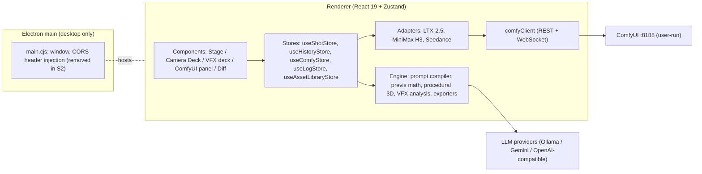

# Architecture — ComfyUI Motion Previs Studio

> **Living document.** Describes the system *as it is now*, plus the target shape per remediation stage.
> The original SVG-era design lives in [`archive/ARCHITECTURE_v1_svg_era.md`](archive/ARCHITECTURE_v1_svg_era.md).
> Last updated: S0 (2026-10-23).

---

## 1. Runtime topology

- **Dev (browser):** Vite at `127.0.0.1:5173` proxies `/api/comfy` → `:8188` and `/ws` → `ws://:8188`.
- **Desktop:** Electron loads `dist/index.html` (or the dev server if it is running; replaced by an explicit `--dev` flag in S2).
- **Persistence:** browser/Electron `localStorage` (keys `comfy_ai_director_*`, `ai_director_*`, `aids.*`). Electron `userData` is pinned to `%APPDATA%\comfy-ai-director-studio`.

## 2. Core data model

`ShotSpec` (`src/types/shotspec.ts`) is the canonical description of a shot: camera (lens, framing, angle, movement, keyframes), actors and objects with trajectories, environment, duration/fps/aspect, optional reference image or video plate. Revisions (`useHistoryStore`) snapshot ShotSpecs for Director Diff.

## 3. Generation path (current, to be replaced in S1)

1. The prompt compiler turns a ShotSpec into a prompt bundle.
2. An adapter builds a ComfyUI graph **in code** and queues it via `/prompt`.
3. Progress arrives over WebSocket; the output is fetched via `/view`.

**Known defects (fixed in S1):** the graph is hand-built (wrong node inputs; video fed to `LoadImage`); the adapter recompiles the prompt instead of using the displayed one; the seed is randomized and not stored; sampler settings are wrong for the distilled model; duplicate revisions; fixed polling timeout.

## 4. Target shape by stage

| Stage | Architectural change |
|---|---|
| S1 | `workflows/templates/*.api.json` + `*.binding.json` → **binding engine** with fingerprint checks; single **JobRunner** (prompt-id-filtered WS, cancel via `/interrupt`, no fixed timeout); prompt override model; revisions store seed + exact submitted workflow + engine/template id; Package mode. |
| S2 | Preload API (`window.aids.http` / `window.aids.llm`) via `net.fetch` in main; `safeStorage` for keys; strict CSP; project folders (`project.aids.json` + `media/`) with Zod-versioned schema + migrations; IndexedDB fallback in browser. |
| S3 | Per-shot undo/redo with structurally shared snapshots; Welcome screen; computed project info. |
| S4 | Deterministic offline renderer (fixed timestep, 8n+1 frames) → layout + depth MP4 via WebCodecs + `mp4-muxer`. |
| S5 | Selector subscriptions, debounced persistence off the hot path, `React.lazy`, WebGL context/disposal audit. |

## 5. Known structural debt (tracked)

- `useShotStore.commitShot` writes + validates + recompiles on every update (S5).
- Several components subscribe to the whole store (S5).
- Each `StagePrevis3D` instance creates two WebGL renderers; the Motion Previs Stage mounts two instances (S5).
- Persistence guards are inconsistent (`typeof window` on some reads/writes only) (S2).
- Uploaded plate blob URLs are persisted but die on reload (S2 media folder).
- localStorage is origin-scoped: desktop data differs depending on whether it loaded `file://` or the dev server (S2 project files remove this).
